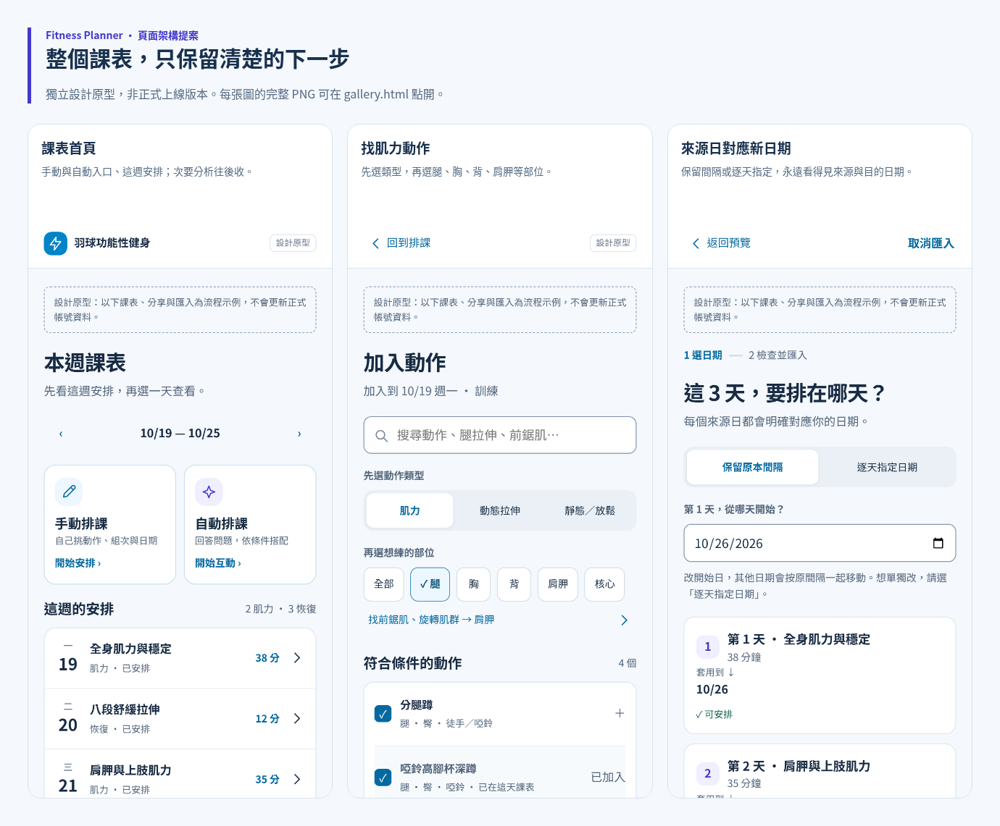

# 課表體驗重新設計：先看畫面，再分階段實作

這份提案保留原有藍／紫色系，將操作整理為三條路徑：

1. **手動排課**：選日期 → 依動作類型與部位快速找動作 → 安排每天的暖身／訓練／收操 → 檢查套用。
2. **自動排課**：選期間 → 回答時間、球日、器材、身體狀態與偏好 → 看完整日期安排 → 修改或套用。
3. **分享與接收**：分享所選 N 天 → 對方先預覽 → 將來源每一天對應自己的日期 → 處理衝突 → 確認匯入副本。

**狀態：獨立設計原型。沒有修改正式 App、排課引擎、帳號資料或部署網站。** 23 張手機圖是流程中的畫面狀態，不是新增 23 個主選單。

## 先看這幾份

**新增：[把某天課表命名收藏，再分享給別人](saved-plans/README.md)**：每日儲存入口、我的課表、重新命名、選日期套用及命名分享，附九張操作畫面。

**新增：[點「加入動作」之後的完整流程與九張圖](add-exercises/README.md)**：分類、搜尋、跨部位多選、收藏、加入確認與複用到其他日期；由同一條實際操作擷取。

- [頁面架構總覽 PNG](overview.png)
- [手動排課完整流程 PNG](flow-manual.png)
- [自動排課完整流程 PNG](flow-auto.png)
- [分享與匯入完整流程 PNG](flow-sharing.png)
- [全部 23 個畫面的 PDF](screenbook.pdf)
- [設計規格、資料規則與實作順序](DESIGN.md)
- [權威資料與易用性評估方法](research.md)
- [四位 agent 審查與修正結果](reviews/summary.md)



下載此資料夾後，可直接開啟 `gallery.html` 看全部圖，開啟 `prototype.html` 操作代表性流程；不需 Firebase、API key 或登入。GitHub 不會直接執行 HTML，請用 PNG／PDF 線上預覽，或下載後開啟 HTML。

## 全部頁面 PNG

| 區域 | 畫面 |
| --- | --- |
| 課表首頁 | [有安排](png/01-week.png) · [尚未安排](png/02-empty.png) · [每日唯讀詳情](png/04b-day-view.png) |
| 手動排課 | [選日期](png/03-dates-manual.png) · [每日工作台](png/04-manual.png) · [找肌力](png/05-pick-strength.png) · [找拉伸](png/06-pick-stretch.png) · [編輯組次](png/07-exercise-detail.png) · [套用前檢查](png/10-plan-preview.png) |
| 自動排課 | [選期間](png/03b-dates-auto.png) · [訓練條件](png/08-auto-goals.png) · [身體狀態](png/09-auto-body.png) · [完整七日預覽](png/10a-auto-preview.png) |
| 分享 | [選分享天數](png/11-share.png) · [連結建立示例](png/11b-share-ready.png) · [接收者預覽](png/12-shared-view.png) · [來源日詳情](png/12b-shared-day.png) |
| 匯入 | [對應新日期](png/13-import-dates.png) · [處理衝突](png/14-import-conflict.png) · [新增確認](png/15-import-review.png) · [替換確認](png/15b-import-replace.png) · [調整自己的副本](png/17-import-adjust.png) · [完成示例](png/16-import-done.png) |

桌面版：[首頁](png/01-week-desktop.png) · [手動工作台](png/04-manual-desktop.png) · [日期對應](png/13-import-dates-desktop.png)。

手機首屏：[首頁](png/01-week-first-fold.png) · [日期對應](png/13-import-dates-first-fold.png)。

整頁長圖為了完整審閱，將固定操作列移到文件頁尾；首屏圖與互動原型保留真正的固定列。不要用長圖判定手機固定列是否遮擋內容。

## 為什麼這樣設計

- 首頁先回答「這週做什麼、我要怎麼排」，目標分析與活動度明細放第二層。
- 動作選擇分成「肌力／動態拉伸／靜態放鬆」與「腿／胸／背／胸椎／髖等部位」；加入的暖身／訓練／收操階段另行顯示，避免把分類與課表階段混為一談。
- 草稿、唯讀預覽、已安排用明確文字區分；只有確認才套用。可見編輯按鈕與上下移動支援不使用長按、拖曳的人。
- 手動與自動共用檢查頁與分享格式，避免維護兩套不同課表。
- 接收者永遠看得見「來源第 N 天 → 我的日期」。既有課表預設換日期；只有明確選擇才替換未開始課表，已有紀錄的日期不能覆蓋。

## 如何評估「直覺好用」

採用 [ISO 9241-11:2018 官方摘要](https://www.iso.org/standard/63500.html) 的有效性、效率、滿意度框架，以 [Nielsen 十項準則](https://www.nngroup.com/articles/ten-usability-heuristics/) 做啟發式檢查，以 [GOV.UK 任務型可用性測試](https://www.gov.uk/service-manual/user-research/using-moderated-usability-testing) 規劃後續真實操作評估；另參照 [WCAG 2.2 點擊區域規範](https://www.w3.org/WAI/WCAG22/Understanding/target-size-minimum)。本提案以 44×44 CSS px 作設計目標，並非將它誤稱為 WCAG AA 的強制門檻。

本次四位 agent 模擬新手、手動編排者、接收者、無障礙檢查者，先看 PNG、再對問題做代表性互動複驗。它們協助找問題，**不等於真人使用者測試**；沒有杜撰 SUS、完成率、時間或滿意度分數。

## 原型已能操作與尚未實作的界線

已連接：命名課表的裝置收藏、重新命名、重開讀取與共用分享／日期流程；建立空白手動草稿、挑選與加入、修改正確動作的組次／休息／階段、上下移動及移除、暫存草稿後重開、預覽與本次工作階段套用；自動流程的條件選擇與回答門檻；選分享子集、接收子集詳情、日期對應、衝突檢查、調整隔離副本。

尚未連接：正式排課計算、跨月份與任意日期範圍資料、完整動作庫與多標籤搜尋、正式收藏同步、帳號、跨裝置、公開分享服務、正式匯入寫入與撤銷。自動預覽是固定七日範例，不會因任意條件改變而產生新的適用課表；時間也只是版面示例。部分進階入口會明示為操作示意。

`fitness.example/s/7Q2M` 是假連結。匯入完成畫面沒有真的寫入課表；原型各頁均提示不更新正式帳號資料。草稿使用獨立 `fitness_planner_design_draft` 本機鍵，與正式產品資料分離。本次套用僅更新原型記憶體中的示例；重新整理後不保證保留套用結果。

研究中仍保留的 P2 問題及正式實作待驗事項見審查摘要，不能由 PNG 或這份原型推定完全符合 WCAG 或已驗證正式資料安全。

## 重現與後續順序

原型無需建置。若要重新產圖，在專案根目錄依序執行（需要既有 Puppeteer 與 Chromium、繁中文字型）：

```sh
node design/planner-v2/check-prototype.mjs
node design/planner-v2/render.mjs
node design/planner-v2/build-deliverables.mjs
```

`prototype.js` 與 HTML 的內嵌 script 內容應保持一致。檢查結果分別在 `prototype-checks.json`、`render-checks.json` 與 `reviews/`；舊版圖在 `archive/`，不能當作最新版設計。

正式實作建議按「首頁與每日閱讀 → 手動工作台 → 自動流程共用預覽 → 多日分享／日期匯入 → 真人任務及無障礙測試」分階段進行。先延用既有資料模型、紀錄保護與免費排課引擎，避免一口氣重寫。完整細節見 [DESIGN.md](DESIGN.md)。
