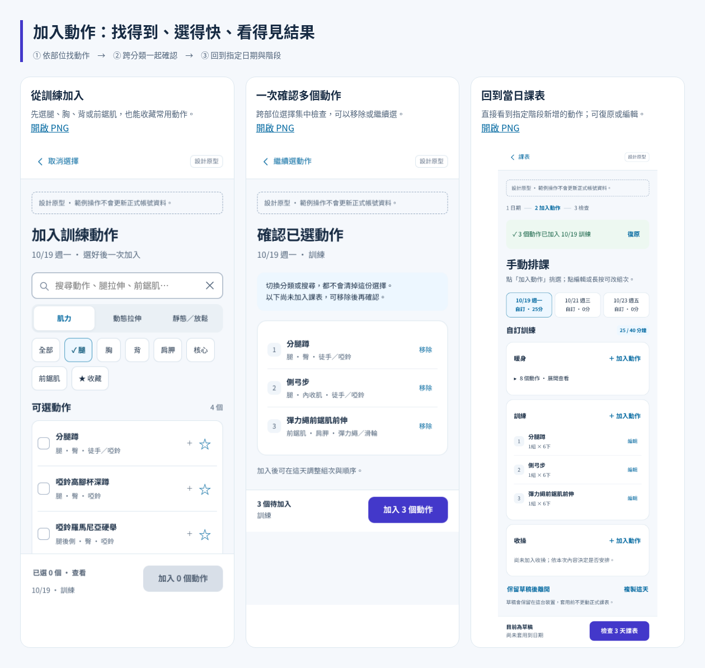

# 點「加入動作」之後：排課的關鍵操作

本次把原本藏在完整圖集中的挑選過程，補成可直接檢視的連續畫面，並接入同一份設計原型。**這次仍只修改設計檔，正式 App 未變更。**

## 直接看畫面

- [完整操作總覽 PNG](flow.png)
- [點訓練的加入動作後，手機實際看到的第一屏](png/03-training-open.png)
- [點暖身的加入動作後，手機實際看到的第一屏](png/01-warmup-open.png)
- [跨分類搜尋前鋸肌，之前的選擇仍保留](png/04-search-across-categories.png)
- [確認一次加入三個動作](png/05-selected-three.png)
- [回到當天，看到三個動作已加入訓練](png/06-added-to-day.png)
- [將暖身與訓練複用到其他日期](png/07-copy-to-other-dates.png)
- [複用後的另一日，可獨立調整](png/08-reused-next-day.png)
- [選整套八段暖身後的清單](png/02-warmup-eight.png)
- [搜尋零結果的處理](png/09-empty-search.png)
- [九頁完整 PDF](screenbook.pdf)



下載後可開啟 `gallery.html` 看全部圖片；開啟上層 `prototype.html?page=03-dates-manual`，從「開始排 3 天」走完整流程。GitHub 上請直接看 PNG／PDF，HTML 需下載後開啟。

## 操作設計

**一、帶著目的進入。** 從暖身進入預設動態拉伸，訓練進入預設肌力，收操進入預設靜態／放鬆。標題一直寫明日期及階段，不必再回答一次「加到哪裡」。類型可切換，預設不是強制限制。

**二、同一頁找、一次選多個。** 直接看腿、胸、背、肩胛、核心、前鋸肌，或拉伸的胸椎、肩胸、髖、腿部、踝小腿。選完腿再切到背、前鋸肌，已選清單不消失。選取順序就是加入順序，加入後可用可見按鈕調整。

**三、搜尋跨類型，避免被篩選困住。** 有關鍵字時明說搜尋全部類型與部位，暫時略過原分類；清除後回原分類。支援「腿拉伸」「胸椎拉伸」「前鋸肌」等本次示例別名。結果數和零結果訊息隨實際清單變動。

**四、常用的不用每次重找。** ☆ 收藏與選取分開，不會收藏了就被排入；收藏篩選只顯示目前類型。暖身提供明確的「每日八段／整套選取」，八段列出後，仍需按加入才進草稿；不偷塞進手動課表。原型收藏只保留本次工作階段，正式收藏持久化仍待接回產品。

**五、確認前保留掌控。** 固定底列顯示「已選 N 個／查看」與「加入 N 個動作」；可看完整已選清單、移除、返回繼續選。零選擇時加入停用；選了但取消時，確認放棄尚未加入的選擇。已有同階段動作明示已加入，避免重複；不同階段可各自安排。

**六、加入後立刻看得到。** 回原日期與階段，持續顯示加入幾個及復原；可直接編輯組次、休息、階段或上下移動。八段暖身可收合，避免主訓練被推到很下面。加入／複用仍只改草稿，正式套用維持最後確認。

**七、排多天不用從頭挑。** 「複製這天」可選有內容的暖身／訓練／收操，再選本次排課的其他日期。只複製到所選階段空白的日期，已有內容就保留並說明；不默默覆蓋或疊加。各天建立獨立副本，日後改某天的組次不會連動。

## 本輪驗證與界線

本次由主 agent 以 Chromium 的可見按鈕、搜尋欄與確認流程操作，沒有新增真人或 sub-agent 測試成績。上一輪四個角色的審查記錄仍保留，不能將它們直接當作本輪所有新功能的驗證。

已檢查六組互動任務：暖身批次；跨部位與搜尋保留選取；搜尋別名、結果數及零結果；收藏、已選檢查與移除；指定日／階段加入及復原；只複製空白階段、各天獨立且保留已有內容。另對四個挑選／確認／複用狀態在 320、390、1440px 檢查橫向溢出與啟用按鈕／輸入區尺寸。結果見 [checks.json](checks.json)。這些不是使用者成功率。

九張圖取自同一段實際操作。首屏保留固定列，長圖為審閱將操作列放在頁尾；靜態截圖隱去短暫 toast，以免遮住內容，持續的加入回饋仍保留。中間做過一次復原驗證，再重加同樣三個動作後拍攝複用流程。

原型的動作庫、時間與組次都是有限示例；沒有正式計算、健康判斷、雲端寫入或公開分享服務。完整動作分類、真實個人收藏持久化、鍵盤／讀屏及觸控實機，仍須在接回正式產品時補完。這次為挑選控制補可存取名稱、選中狀態及操作狀態區域，但不宣稱解決全站無障礙問題。

## 重現

在專案根目錄執行（使用既有 Puppeteer／Chromium 與繁中文字型）：

```sh
node design/planner-v2/add-exercises/check-and-render.mjs
node design/planner-v2/add-exercises/build.mjs
```
