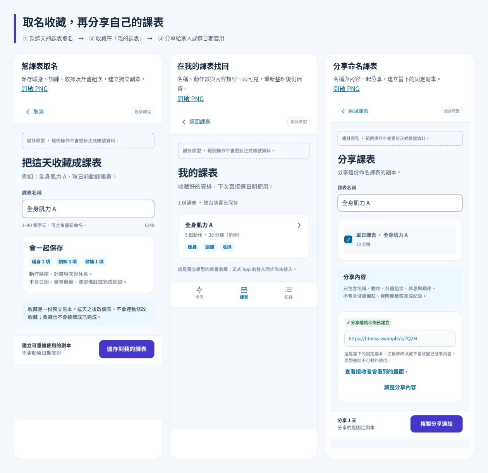

# 把這天的安排命名收藏，並分享給別人

這是同一份設計原型的功能補充，**沒有修改正式 App 或部署網站**。本機收藏、重新命名及重開讀取已接通；公開分享、正式匯入與帳號同步仍是流程示例。

## 直接看畫面

- [命名 → 我的課表 → 分享：總覽 PNG](flow.png)
- [每天課表上的儲存與分享入口](png/01-day-entry.png)
- [幫課表取名字](png/02-name-template.png)
- [收藏到我的課表](png/03-my-library.png)
- [查看、重新命名、套用或分享](png/04-template-detail.png)
- [套用到自己的新日期](png/05-choose-my-date.png)
- [建立命名分享的示例](png/06-share-named-template.png)
- [接收者看到同樣名稱與內容](png/07-recipient-preview.png)
- [接收者選好自己的日期再確認](png/08-recipient-date-review.png)
- [尚未收藏時的入口](png/00-empty-library.png)
- [九頁完整 PDF](screenbook.pdf)



下載後開啟本資料夾的 `gallery.html` 看圖片；開啟上層 `prototype.html?page=04-manual`，按「儲存為課表」體驗。GitHub 請直接看 PNG／PDF；HTML 下載後才能執行。

## 使用方式

1. 在某一天的草稿或已安排詳情，按 **儲存為課表**。空白課表不能儲存。
2. 取名，例如「全身肌力 A」「球日前動態暖身」。保存這天的暖身、訓練、收操、順序、計畫組次與休息。
3. 從課表首頁的 **我的課表** 找回。這是整份課表，與動作庫的單一動作 ☆ 收藏分開。
4. 點開可看完整內容、**重新命名**、**選日期套用**或**分享這份課表**。
5. 也可從當天直接按 **分享這天**，不強迫先收藏。分享者可調整分享名稱，接收者看到的是同樣的名稱與內容。
6. 接收者預覽後，用原有流程選自己的日期、檢查衝突，再確認匯入。自己的收藏也沿用同一套日期檢查，畫面文案改為「套用」，避免另外學一套操作。

## 明確的保存與副本規則

- 收藏不綁原日期，沒有完成狀態，不沿用原作者的完成勾選。
- 收藏只挑出計畫欄位。日期、實做紀錄、實際重量、健康備註不進收藏或分享內容；建立時間是收藏本身的管理資料，不是原訓練日期。
- 收藏、日期安排、分享都是獨立副本。修改某一天不會改到收藏；之後重新命名收藏也不會改掉已建立的分享。
- 名稱為 1–40 個字元，修剪前後空白。同名時提示換名字，不默默覆蓋；重新命名維持同一個收藏 ID，不多生一份課表。
- 名稱是純文字，符號會照文字顯示；長名稱在手機上可換行。
- 原型收藏存在專用 `fitness_planner_design_templates` 裝置鍵，與正式產品資料分開。重新整理後仍可從「我的課表」找回；若裝置無法寫入，顯示失敗而非成功。
- 本次沒有加入資料夾、公開社群或新底部分頁，先保留名稱清單與清楚的單一操作。

## 分享服務的界線

`https://fitness.example/s/7Q2M` 是示例，不是可給朋友使用的真實公開連結。原型能驗證名稱、內容、固定副本及接收日期流程，尚未建立公開快照服務。確認／完成頁仍明示原型不更新正式帳號資料。

正式接回產品時，私有收藏需按帳號儲存；分享沿用設計中的多日 v2 快照與短分享 ID，保留既有 v1 連結相容。分享只讀快照，不能讓接收者改寫作者的收藏。套用沿用現有受保護日期與原子寫入邏輯，不需要 Gemini 或 API key。

## 本輪驗證

由主 agent 用 Chromium 操作，不是真人研究，也未重新宣稱四位先前審查 agent 已測過本輪功能。結果見 [checks.json](checks.json)。

六組任務：空白／名稱要求；保存後重新整理與最小計畫欄位；重新命名及同名不覆蓋；自己的收藏套用日期並取消；同名單日分享與接收者日期確認；修改後副本隔離及名稱文字顯示。另檢查六個狀態 × 320／390／1440px 共 18 組，沒有橫向溢出或低於專案 44px 目標的啟用按鈕／輸入區。原有 69 組版面及四條核心流程也補做回歸。

主要流程用可見按鈕與欄位完成；計畫欄位排除與副本隔離另以檢查原型狀態的方式驗證。沒有宣稱它們等同後端資料隔離、真實分享、帳號持久化或全面 WCAG 驗證，也沒有製造使用者成功率或滿意度分數。

圖片取自上述操作，隱去短暫 toast，長圖將固定操作列放到文件頁尾以方便審閱。命名測試含重新命名再改回原名，以確認所有主要圖片名稱一致。時間與劑量仍是有限版面示例，未使用正式排課引擎。

## 重現

在專案根目錄執行：

```sh
node design/planner-v2/saved-plans/check-and-render.mjs
node design/planner-v2/saved-plans/build.mjs
```
